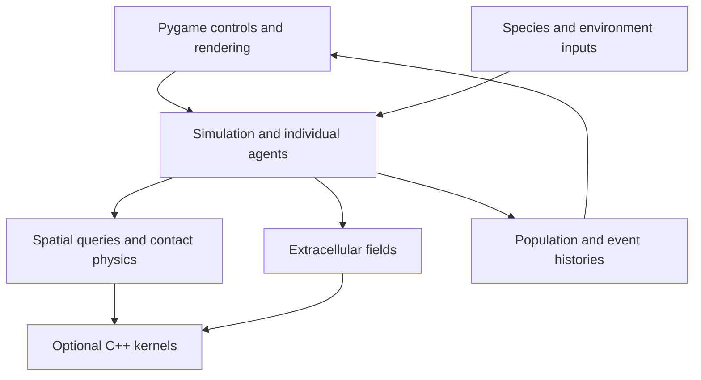

# A short guide to BacSandbox

BacSandbox combines an interactive simulation, inspectable model assumptions, and tools for testing the implementation. The guide connects the working software to the design decisions expressed in its source.

## What to try first

1. Run `python examples/portfolio_demo.py` to see the existing agent engine advance a bounded synthetic example. The wrapper uses invented population names and explicit Python backends.
2. Run `python -m bacteria` and click **Play** to explore the original desktop interface. Inspect the species parameter table and the population graph.
3. Read `Simulation.update` in [`core_sim.py`](bacteria/core_sim.py), then the architecture below. Use Git history to see how the implementation evolved.

The demo wrapper was added for this public preview. It is presentation code around the existing engine; its illustrative settings are not a newly registered experiment or research result.

## How the pieces fit

The main loop separates the screen and controls from model state. Individual agents carry position, size, reserves, and physiological state. The simulation advances movement, nutrient use, interactions, and lifecycle rules, then records population and event histories.

Spatial lookup avoids comparing every cell with every food node or contact partner. Extracellular fields use a sparse grid. C++17/pybind11 kernels provide optional acceleration for fields and contact processing; Python paths remain available for execution and comparison.

A separate, opt-in reduced-metabolism path adds dietary molar translation, a reduced constraint-based model, caching, and a live-agent adapter. It is not the desktop application's default metabolism. The adapter has explicit state ownership and rollback/conservation checks; these are engineering safeguards, not evidence that its assumed rates are biologically established.

## Design decisions to inspect

| Decision | Why it matters | Code to read |
| --- | --- | --- |
| Separate simulation state from the interface | The same engine can run interactively or through a headless harness. | `bacteria/app.py`, `bacteria/core_sim.py` |
| Local spatial queries and sparse fields | Computational effort follows nearby interactions and active field cells. | `bacteria/core_sim.py`, `bacteria/physics.py`, `bacteria/ecm.py` |
| Optional native kernels with reference paths | Acceleration can be checked against an inspectable implementation. | `bacteria/src/`, `bacteria/test_kernel.py`, `bacteria/test_physics_kernel.py` |
| Explicit model assets and units | Assumed coefficients and reduced-model structure remain inspectable. | `bacteria/models/`, `bacteria/diet_translator.py` |
| Transactional metabolic integration | Failed updates should not silently leave partially advanced biological state. | `bacteria/metabolic_integration.py`, `bacteria/test_metabolic_integration.py` |
| Separate empirical preparation and experiment workflows | Preparing a dataset, executing a simulation, and qualifying a comparison remain distinct operations. | `research/data_readiness/`, `research/zhou_reference/`, `research/spatial_nutrient/` |

The detailed equations, parameter meanings, numerical contracts, and literature references are in [`DOCUMENTATION.md`](DOCUMENTATION.md). Historical documentation may reference private working records excluded from this preview. It should be read as source-revision documentation, not as a claim that all proposed research is completed.

## Research infrastructure as an engineering component

The repository includes headless experiment runners, immutable input registration, deterministic seeds, event and trajectory logging, evidence audits, and qualification gates. These tools make simulated runs inspectable and help distinguish a technical failure from an ecological outcome. Their implementation and tests are available under `research/`.

The public preview preserves this infrastructure and its development history. It is a versioned engineering demonstration, rather than a live record of research progress. The viewer uses synthetic inputs; biological predictive accuracy has not been established.

## Contributions and assistance

BacSandbox is Zachary Zheng's project. The retained history is the record of implementation changes and attribution available in this release. The project has used AI assistance, including implementation, testing, and documentation work. Commit names and commit counts alone should not be interpreted as a precise accounting of independent authorship or time spent.

Research mentorship informed the questions and scrutiny applied to model assumptions. Private mentor correspondence is not reproduced, and the preview does not imply that a mentor endorsed every mechanism or conclusion. Published source references are retained where used; third-party libraries and sources keep their own attribution and license terms.

This public-preview preparation—including the synthetic viewer and reviewer-facing documentation—was assisted by ChatGPT/Codex. It leaves the simulator implementation separate from the new presentation layer. [The history disclosure](HISTORY.md) records how the public copy was derived and why sanitized commits have different hashes.
